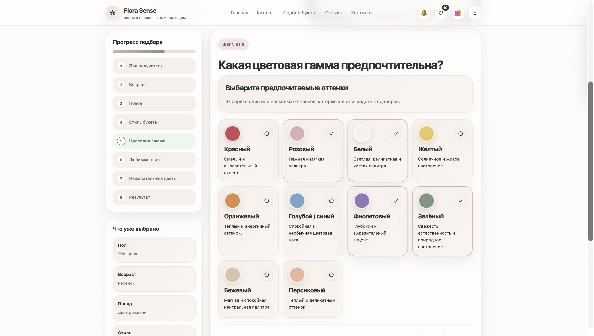
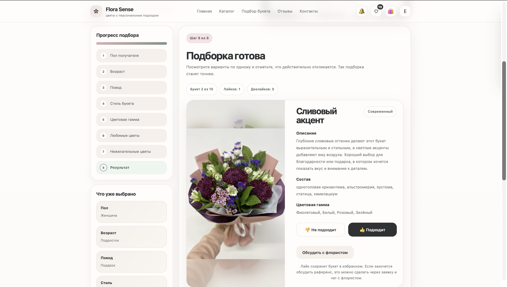
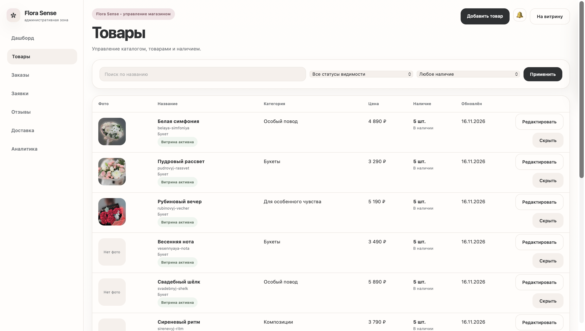
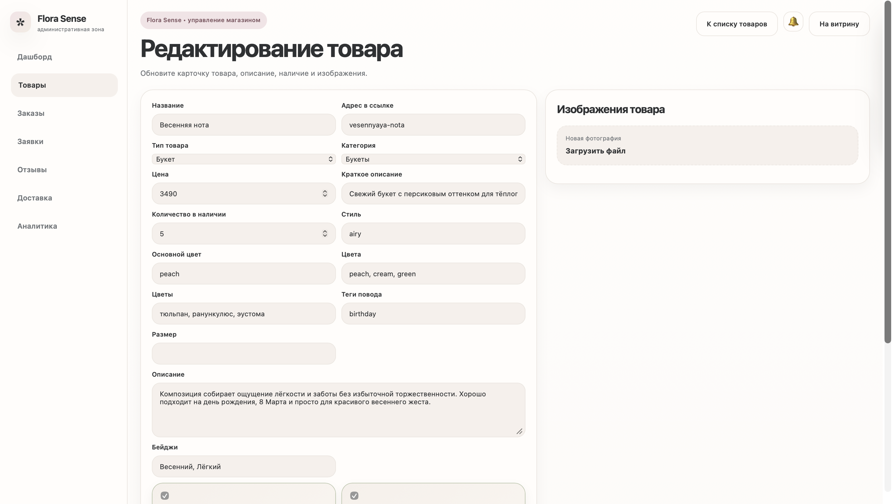
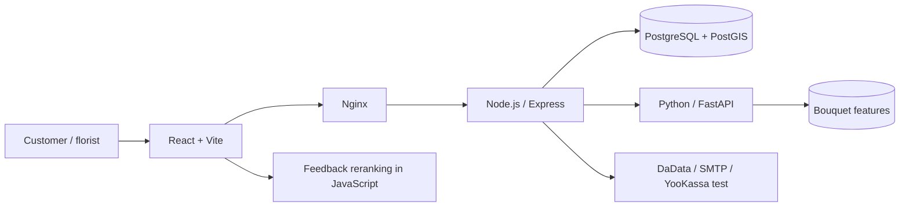

# Flora Sense

**English** | [Русский](README.ru.md)

Flora Sense is a flower shop web application with personalized bouquet recommendations. I developed it in 2025-2026 at the request of a flower shop, while also working on my graduation project.

The full application remains in a private repository. This one is a technical showcase of the work, with screenshots, a video walkthrough and runnable recommendation code. The demo uses a synthetic catalog, not the shop's product data or customer records.

## The application

The shop combines a conventional ordering flow with a guided bouquet quiz. Visitors can browse the catalog, save favorites, place orders and request a custom arrangement. The administrative interface covers products, orders, custom requests and delivery settings.

I built the React frontend, Node.js/Express backend and PostgreSQL database, including PostGIS delivery zones. The application also integrates DaData for address suggestions, email confirmation and password recovery, and YooKassa in test mode. Docker Compose and Nginx connect the services.

For me, the most interesting part was the recommendation engine. I wanted the quiz to produce meaningful matches rather than a fixed selection of popular bouquets.

## Screenshots and video

[Watch the original screen recording](https://github.com/Evme22/flora-sense/releases/tag/demo-2026-11) (1 min 40 sec, no narration). The link will be available after the video is attached to the GitHub release.

| Bouquet quiz | Recommendation results |
| :---: | :---: |
|  |  |

| Product management | Product editor |
| :---: | :---: |
|  |  |

## Architecture



This diagram describes the complete application, not the contents of this repository. The backend, database schema, shop assets and deployment configuration are private. The recommendation-related code published here runs independently. The boundaries are described in [architecture notes](docs/architecture.md).

## Recommendation engine

The initial ranking uses a **content-based approach**. Questionnaire answers are compared with the attributes of each bouquet. The algorithm removes arrangements containing unwanted flowers and, when a color preference is specified, applies a minimum color-match threshold.

Each eligible bouquet receives a weighted score:

```text
score = 8.4 × colors + 3.1 × flowers + 1.8 × style
      + 1.2 × gender + 1.1 × age + 0.7 × occasion
```

These are relative feature weights. Color matching gives more importance to the primary color than to the secondary color or general palette. Favorite flowers contribute a bonus but are not mandatory.

The initial ranking runs in **Python**. After a user likes or dislikes a bouquet, **JavaScript** can change the order of recommendations that have not yet been shown. Already viewed items stay in place. A reaction does not necessarily change the order, since the initial scores still matter.

The [original Python ranking implementation](recommender/prototype/bouquet_recommender_v1.py) and [session reranking module](session-reranking/sessionReranking.js) are available for review. A small [FastAPI adapter](recommender/app/) makes the baseline runnable without the rest of the shop.

## Run the demo

The API reads 12 synthetic bouquets from an Excel file. It does not require PostgreSQL, external services or API keys. Use Python 3.10 or newer.

```bash
cd recommender
python3 -m venv .venv
source .venv/bin/activate
pip install -r requirements-dev.txt
uvicorn app.main:app --reload --port 8000
```

Open [http://127.0.0.1:8000/docs](http://127.0.0.1:8000/docs) to try the endpoint in Swagger UI, or send a request directly:

```bash
curl -X POST http://127.0.0.1:8000/recommend \
  -H 'Content-Type: application/json' \
  -d '{
    "gender": "female",
    "age_group": "adult",
    "favorite_colors": ["pink", "white"],
    "favorite_flowers": ["роза", "эустома"],
    "unwanted_flowers": ["лилия"],
    "occasion": "birthday",
    "style": "romantic",
    "top_n": 5
  }'
```

The response contains matching bouquets and their scores, without the private shop's images. To run the Python tests, use `python -m pytest -q` from `recommender/`. The JavaScript reranking tests run with `npm test` from `session-reranking/` and require Node.js.

## Learning-to-rank experiment

I also explored whether a learned ranking model could improve the content-based baseline. The offline experiment used **CatBoostRanker** with `YetiRankPairwise` and feedback collected during recommendation sessions.

The recorded run on May 17, 2026 contained 140 impressions. Only 30 interactions had explicit labels, spread across three sessions. Two sessions were used for training and one for validation.

| Validation metric | Content-based baseline | CatBoostRanker |
| --- | ---: | ---: |
| NDCG@5 | **0.661** | 0.515 |
| NDCG@10 | **0.805** | 0.776 |
| Hit rate@5 | 1.000 | 1.000 |
| MRR@10 | 0.500 | 0.500 |

The model did not outperform the baseline in this run, so I kept it out of the user-facing recommendation flow. A validation set of one session is far too small for broad conclusions. The result was useful as a check on whether the available data justified deploying a trained model.

The repository includes the [evaluation metrics code](recommender/training/metrics.py) and [experiment notes](docs/ml-experiments.md). The original feedback records, training pipeline and trained model are not published, so these results cannot be reproduced from the synthetic demo catalog.

## About this repository

This is not a deployable copy of the flower shop. It contains the recommendation algorithm, a standalone API, session reranking, tests, synthetic sample data and documentation. The full commercial application remains private, and no publicly hosted version is currently available.

The project was commissioned by a flower shop and also submitted as my graduation project. I do not claim a particular sales volume, production load or payment arrangement.

The source is shared for technical review. **No open-source license has been granted**; please contact me before reusing or redistributing the code.

Developed by [Evme22](https://github.com/Evme22).
