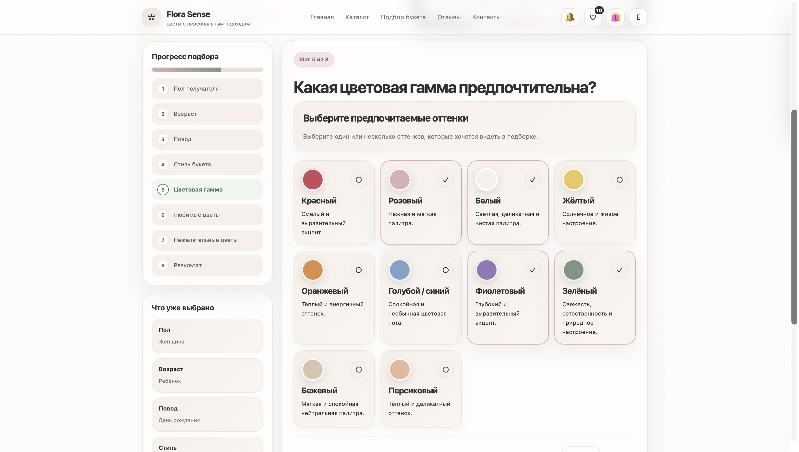
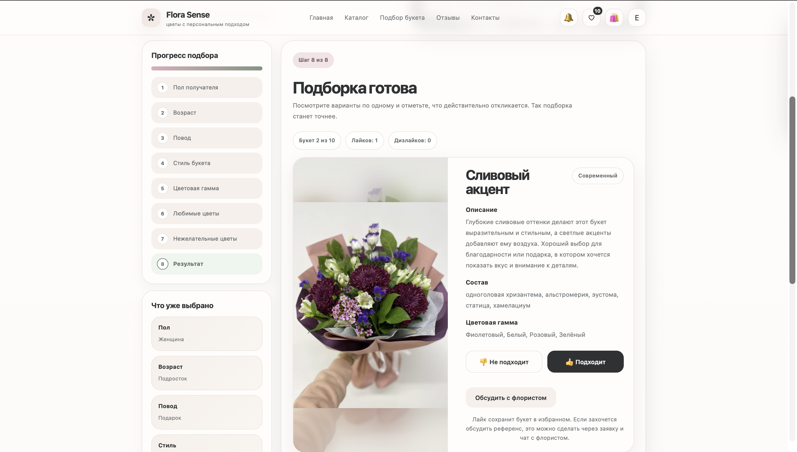
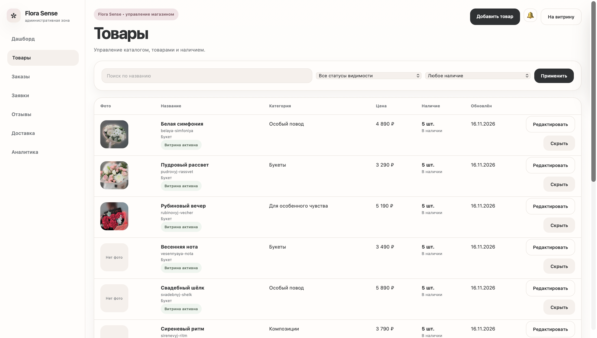
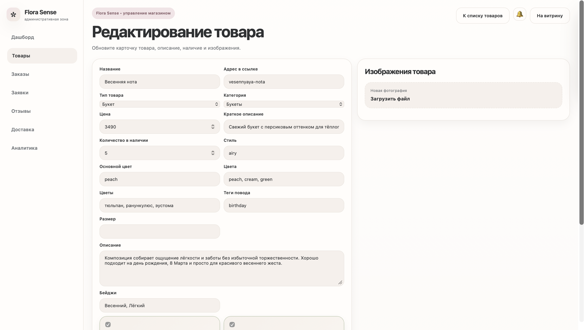
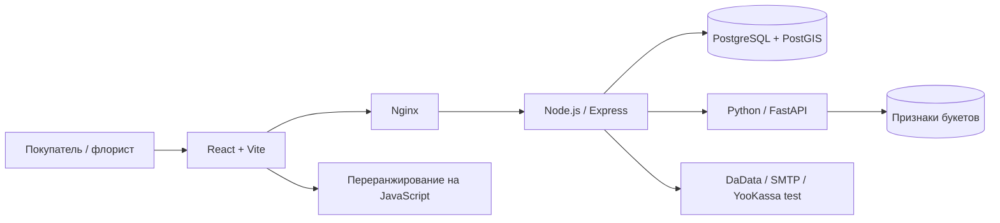

# Flora Sense

[English](README.md) | **Русский**

Flora Sense представляет собой интернет-магазин цветов с персональным подбором букетов. Я разрабатывала его в 2025-2026 годах по заказу цветочного магазина. Одновременно проект стал основой моей выпускной квалификационной работы.

Полный исходный код магазина находится в приватном репозитории. Здесь я показываю результат разработки, архитектуру и работу рекомендательной системы. В публичной версии можно запустить алгоритм на синтетическом каталоге, не используя данные магазина и покупателей.

## Что представляет собой проект

В Flora Sense есть каталог, карточки товаров, избранное, корзина и оформление заказов. Пользователь также может пройти анкету для подбора букета или обратиться к флористу с индивидуальным запросом. В административной части предусмотрено управление товарами, заказами, заявками и доставкой.

Я реализовала клиентскую часть на React, сервер на Node.js и Express, базу данных PostgreSQL и расчёт зон доставки через PostGIS. Для подсказок адресов используется DaData, для подтверждения почты и восстановления доступа предусмотрены почтовые уведомления. Оплата интегрирована через тестовый режим YooKassa. Сервисы объединены с помощью Docker Compose и Nginx.

Главной технической задачей для меня стала система рекомендаций. Хотелось, чтобы анкета действительно учитывала предпочтения человека, а не просто показывала заранее выбранные популярные букеты.

## Скриншоты и демонстрация

[Посмотреть оригинальную запись экрана](https://github.com/Evme22/flora-sense/releases/tag/demo-2026-11) (1 минута 40 секунд, без озвучки). Ссылка заработает после публикации видео в GitHub Releases.

| Анкета подбора | Результаты рекомендаций |
| :---: | :---: |
|  |  |

| Управление товарами | Редактор товара |
| :---: | :---: |
|  |  |

## Архитектура



На схеме показан полный магазин. В этом репозитории нет закрытого backend, базы данных, товарных изображений и конфигурации развёртывания. Опубликованные компоненты рекомендательной системы запускаются отдельно. Подробнее границы публичной версии описаны в [документе об архитектуре](docs/architecture.ru.md).

## Как работает подбор букетов

Основой служит **content-based алгоритм**. Он сравнивает ответы анкеты с характеристиками букетов и рассчитывает оценку соответствия для каждого варианта. Букеты с нежелательными цветами исключаются. Если человек указал любимые цвета, дополнительно проверяется минимальный порог совпадения по цветовой гамме.

Итоговая оценка складывается из нескольких взвешенных составляющих:

```text
score = 8.4 × colors + 3.1 × flowers + 1.8 × style
      + 1.2 × gender + 1.1 × age + 0.7 × occasion
```

Это относительные веса признаков. Основной цвет букета влияет на оценку сильнее дополнительного и общей палитры. Любимые цветы дают бонус, но не становятся обязательным условием.

Первоначальное ранжирование выполняется на **Python**. После лайка или дизлайка **JavaScript** может изменить порядок ещё не просмотренных букетов. Уже показанные рекомендации остаются на своих местах. При этом реакция не обязательно приводит к перестановке, исходные оценки тоже продолжают учитываться.

В репозитории лежат [оригинальный алгоритм на Python](recommender/prototype/bouquet_recommender_v1.py), [код переранжирования](session-reranking/sessionReranking.js) и [адаптер на FastAPI](recommender/app/), который позволяет проверить базовые рекомендации без запуска магазина.

## Локальный запуск

Для демонстрации подготовлен каталог из 12 синтетических букетов. PostgreSQL, API-ключи и внешние сервисы не нужны. Понадобится Python версии 3.10 или новее.

```bash
cd recommender
python3 -m venv .venv
source .venv/bin/activate
pip install -r requirements-dev.txt
uvicorn app.main:app --reload --port 8000
```

После запуска открой [http://127.0.0.1:8000/docs](http://127.0.0.1:8000/docs). Там можно отправлять запросы через Swagger UI. Тот же запрос из терминала выглядит так:

```bash
curl -X POST http://127.0.0.1:8000/recommend \
  -H 'Content-Type: application/json' \
  -d '{
    "gender": "female",
    "age_group": "adult",
    "favorite_colors": ["pink", "white"],
    "favorite_flowers": ["роза", "эустома"],
    "unwanted_flowers": ["лилия"],
    "occasion": "birthday",
    "style": "romantic",
    "top_n": 5
  }'
```

В ответе возвращаются подходящие букеты и их оценки, без фотографий из закрытого каталога. Тесты Python запускаются командой `python -m pytest -q` из папки `recommender/`. Для проверки JavaScript-переранжирования выполни `npm test` в `session-reranking/`. Здесь понадобится Node.js.

## Эксперимент с CatBoostRanker

Дополнительно я проверила, сможет ли обучаемая модель лучше упорядочивать букеты по пользовательской обратной связи. Для офлайн-эксперимента использовался **CatBoostRanker** с функцией потерь `YetiRankPairwise`.

В эксперименте от 17 мая 2026 года было 140 показов рекомендаций. Явную обратную связь получили только 30 позиций из трёх сессий. Для обучения использовались две сессии, для проверки одна.

| Метрика на проверочной выборке | Базовый алгоритм | CatBoostRanker |
| --- | ---: | ---: |
| NDCG@5 | **0.661** | 0.515 |
| NDCG@10 | **0.805** | 0.776 |
| Hit rate@5 | 1.000 | 1.000 |
| MRR@10 | 0.500 | 0.500 |

На этой выборке CatBoostRanker не превзошёл базовый алгоритм, поэтому я не стала использовать его для пользовательских рекомендаций. Одна проверочная сессия не позволяет делать надёжные выводы о качестве модели в целом. Но эксперимент показал, что имеющихся данных пока недостаточно, чтобы обоснованно заменять базовое ранжирование.

В открытом доступе есть [функции расчёта метрик](recommender/training/metrics.py) и [описание эксперимента](docs/ml-experiments.ru.md). Данные пользовательских взаимодействий, полный обучающий конвейер и файл модели остались приватными. Поэтому воспроизвести обучение по синтетическому каталогу нельзя.

## О публичной версии

Это не полная копия магазина для развёртывания. Репозиторий содержит рекомендательный алгоритм, отдельный API, код обработки обратной связи, тесты, синтетические данные и документацию. Полный коммерческий проект остаётся закрытым. Публично доступного работающего сайта сейчас нет.

Flora Sense разрабатывался по заказу цветочного магазина и одновременно использовался как дипломный проект. Я не заявляю неподтверждённые показатели продаж, нагрузки или условия оплаты разработки.

Исходный код открыт для технического ознакомления. **Лицензия с правом свободного использования не предоставлена**. Если вы хотите использовать или распространять код, пожалуйста, свяжитесь со мной.

Автор: [Evme22](https://github.com/Evme22).
